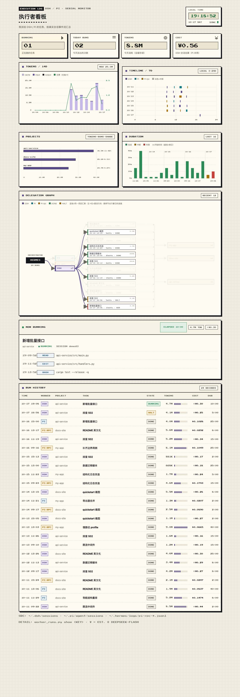

# Worker Dashboard — a pixel board for your coding agents

**English** · [简体中文](README.zh-CN.md)

> One page that answers: **what did I hand to the agents today, which one is
> still running, what did each step cost, and where did the tokens go.**

A single-file, zero-dependency dashboard for local coding agents. It reads the
session logs that DSH (headless), Pi and Pi RPC already write to disk, and
renders one paper-and-pixels board: KPIs, 14-day token flow, 7-day timeline,
project split, run durations, the delegation graph, the live task and the full
run history.



## What's on the board

| Block | What it shows |
|---|---|
| 4 KPI cards | running now · dispatches today · tokens today (cache included) · cost today, split into DSH / Hermes / Pi·Codex so the visible parts add up to the total |
| `TOKENS / 14D` | stacked cache / input / output bars per day, with the cost curve on top |
| `TIMELINE / 14D` | a local 0–24h timeline: one row per day, lanes packed by real concurrency; only **active intervals** are drawn (idle > 20 min splits a segment), so a session resumed the next day is not one fake 13-day bar. Header toggle: `ALL` / `DELEGATED` |
| `PROJECTS` | tokens, run count and share per workspace |
| `PROCESSES` | the agent processes actually running right now — real OS PID, project, elapsed, CPU, task |
| `DELEGATION GRAPH` | orchestrator → worker → task nodes → workspace, one lane per dispatch; **hover a node to keep only its links lit**, click to pin, `Esc` to clear |
| `NOW RUNNING` | the current task with its last tool calls, elapsed time, tokens, cost |
| `RUN HISTORY` | every run: time, worker, project, task, state, tokens (12-cell bar), cost (CNY; hover for the price basis and the token split), duration (active time) |

Each card carries its own control in the panel header: the token chart picks its
range (7 / 14 / 30 days), the timeline its scope (all / delegated) and its own
range, projects how many to show (4 / 6 / 10), the graph how many runs to draw
(6 / 12 / 24), the history table its row count (20 / 50 / 100). The language switch
(中文 / EN) sits under the clock. Everything is encoded in the URL, so a view is
shareable: `?days=30&tdays=14&projs=4&graph=24&rows=100&lang=en&scope=all`.

### Slices (from the ledger)

The `SLICES` panel sits between the delegation graph and `NOW RUNNING`. It reads
the read-only SQLite ledger written by `af_ledger.py`
(`~/.hermes/state/agent_flow/ledger.db`, override with `AF_LEDGER`): slices are
grouped by request with state, executor, attempt, last verdict, runs and update
time, and the header switches a 7 / 14 / 30-day window. Record one with:

```bash
python3 af_ledger.py new-slice --req <ID> --goal "…" --executor pi
```

Switching a control swaps the DOM in place instead of navigating: hovering a chip
prefetches that variant (~0.1 s), so the click lands immediately and the scroll
position is kept. The server reuses one collection for 4 s and caches per-file
parsing by mtime, so a range switch is a re-render, not a re-scan of every session.

### Reading the delegation graph

- Hover any node — `HERMES`, a worker, a single task, or a workspace — and only
  its links stay lit; everything else fades to 12%.
- Click a node to **pin** the focus; auto-refresh pauses while pinned so the view
  does not jump under the pointer. `Esc` or a click on empty space clears it.
- `?focus=w:DSH` pins from the URL: `t:<key>` a task, `w:<worker>` a worker,
  `p:<project>` a workspace.

Refresh is a plain `<meta http-equiv="refresh">` — no JS framework, no build
step, no network calls. The page is re-rendered on every request (the collection
is reused for 4 s and per-file parsing is cached by mtime), so what you see is
always the state of the logs at that moment.

## Quick start

```bash
# one-shot: write the HTML to ~/.hermes/cache/worker-dashboard-pixel.html
python3 worker_dashboard.py --style pixel --open

# live board (regenerates on every request; the page reloads itself every 5s)
python3 worker_dashboard.py --style pixel --serve 8799
# → http://127.0.0.1:8799/

# fictional data, nothing read from your machine (screenshots / first look)
python3 worker_dashboard.py --style pixel --demo --serve 8801
```

Options:

| Flag | Meaning |
|---|---|
| `--style pixel` | the retro pixel board (default is `clean`, a plain light table) |
| `--lang zh\|en` | UI language for the one-shot render (the served page also takes `?lang=`) |
| `--days N` | chart range: 7, 14 or 30 |
| `--rows N` | history rows: 20, 50 or 100 |
| `--graph N` | runs drawn in the delegation graph: 6, 12 or 24 |
| `--tdays N` | timeline days: 7, 14 or 30 |
| `--projs N` | projects shown: 4, 6 or 10 |
| `--scope all\|dg` | timeline scope: `all` includes the Hermes main loop, `dg` only delegated work |
| `--serve PORT` | serve on 127.0.0.1 and re-collect on each request |
| `--demo` | synthetic sessions — safe for screenshots, reads no local files |
| `--refresh N` | auto-reload interval in seconds (default 5, `0` disables) |
| `--no-refresh` | same as `--refresh 0` |
| `--out FILE` | where to write the one-shot HTML |

Requirements: `python3` (standard library only) and the `zstd` CLI
(`brew install zstd`) — DSH session files are zstd-compressed JSONL streams.

## Where the data comes from

| Worker | Source |
|---|---|
| DSH headless | `~/.dsh/sessions/**/session.v4.jsonl.zstd` |
| Pi (one-shot) | `~/.pi/agent/sessions/**/*.jsonl` |
| Pi RPC (persistent) | `~/.hermes/logs/pi-rpc-<name>.jsonl` |
| Hermes sessions (desktop / tui / cron) | `~/.hermes/state.db` → `sessions` + `session_model_usage` |
| Hermes sub-agents | `~/.hermes/state.db` → `async_delegations` |
| Codex CLI | `~/.codex/sessions/**/*.jsonl` |

Each source is keyed by its own session id, so nothing is double counted: a
Hermes sub-agent is a delegation row, a DSH session is a session file, a Codex run
is a rollout. `PROCESSES` additionally reads `ps` / `lsof` to show the live OS
process (with its real PID) behind each running task.

Everything is read-only: the dashboard never writes into a session directory.
Session state (`RUNNING` / `done` / `interrupted`) comes from the event stream
plus the session's own bookkeeping, not from guessing.

## Cost model

**All six workers use one price table and one currency (CNY).** Mixing "DSH in ¥,
Pi in $, Hermes in $" is why the old cost card made no sense — those numbers
cannot be added, and the headline only covered DSH.

- Price: deepseek-flash list price — ¥0.02/M cache hit, ¥1/M uncached input,
  ¥4/M output; doubled during peak hours (weekdays 09–12 and 14–18, Beijing).
- Derived from tokens: `cache × 0.02 + input × 1 + output × 4` (CNY, then ×2 in
  peak hours). Peak/idle is decided from the session start time, so a very long
  session that spans both is an approximation.
- The KPI card lists **DSH / Hermes (main loop + sub-agents) / Pi·Codex**, and the
  three visible numbers add up to the total. Hover it for the price basis and the
  "this is not an invoice" note.
- Costs in the run table are CNY too; hover a row to see its token split and the
  upstream self-reported `$`.

These are estimates, not invoices: they come from the usage counters each agent
logs, not from DeepSeek's billing. Hermes' own `estimated_cost_usd` uses a
different (older) USD table, so it is no longer mixed in — everything is
recomputed from the CNY price above.

## Privacy

`--demo` generates a fixed synthetic dataset (three fictional projects, 24
runs), so the screenshot above and any public demo contain no real project
names, paths or task text. The normal mode never leaves your machine: the page
is a local file or a `127.0.0.1` server.

## Alternative view

`agent_flow.py` (same repo) is a second front end: an SVG topology driven by a
small JSON ledger, useful when you want to replay yesterday and see the
parent → child dispatch edges rather than a flat run table. Both read the same
worker logs; neither writes to them.

## Font

The pixel UI embeds [Press Start 2P](https://fonts.google.com/specimen/Press+Start+2P)
(SIL Open Font License 1.1, see `assets/OFL.txt`) as base64 inside the HTML, so
the page renders identically offline. If the font file is missing the page
falls back to the system monospace face.

## License

MIT — see [LICENSE](LICENSE).
