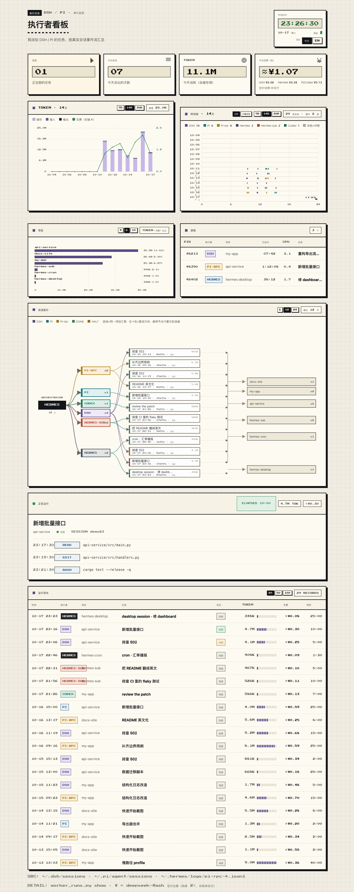

# Worker Dashboard —— 给编码 agent 用的像素风看板

[English](README.md) · **简体中文**

> 一页回答：**今天我把活派给了谁、谁还在跑、每一步花了多少、token 都去哪了。**

单文件、零依赖的本地看板。它读 DSH（headless）、Pi、Pi RPC 本来就会写在本机的
会话日志，渲染成一页纸色像素看板：KPI、14 天 token 流、7 天时间线、项目分布、
运行时长、派活拓扑、当前任务和全部运行流水。



## 图上有什么

| 区块 | 内容 |
|---|---|
| 4 张 KPI 卡 | 在跑 / 今日派活次数 / 今日 token（含缓存读）/ 今日花费估算（拆成 DSH、Hermes、Pi/Codex 三行，相加等于合计） |
| `TOKENS / 14D` | 按天堆叠 cache / input / output，叠加花费曲线 |
| `TIMELINE / 14D` | 本地 0–24 点的时间线：一天一行，行内按真实并发分道；只画"活跃区间"（空闲 >20 分钟断开），所以隔天恢复的会话不会变成一条假长条。标题栏可选 `全部` / `只看派活` |
| `PROJECTS` | 每个工作区的 token、次数、占比 |
| `PROCESSES` | 此刻真正在跑的 agent 进程：真实 OS PID、项目、已运行、CPU、任务 |
| `DELEGATION GRAPH` | 编排 → 执行者 → 任务节点 → 工作区，一次派活一条车道；**悬停节点只亮它的连接**，点击锁定，`Esc` 取消 |
| `NOW RUNNING` | 当前任务 + 最近几次工具调用 + 已运行时长 + token + 花费 |
| `RUN HISTORY` | 全部流水：时间 / 执行者 / 项目 / 任务 / 状态 / token（12 格量级条）/ 花费（元，悬停看单价与 token 拆分）/ 耗时（活跃时长） |

每张卡片在自己的标题栏右侧带控件：token 图选天数（7/14/30），时间线选范围（全部/只看派活）
和它自己的天数，项目图选显示几个（4/6/10），拓扑选画几次派活（6/12/24），流水表选行数（20/50/100）；
语言切换（中文/EN）在右上时钟下面。选择全部写进 URL，可以直接分享：
`?days=30&tdays=14&projs=4&graph=24&rows=100&lang=en&scope=all`。

### 切片面板（读账本）

`SLICES` 面板在派活拓扑和 `NOW RUNNING` 之间，数据只读自 `af_ledger.py` 写的
SQLite 账本（`~/.hermes/state/agent_flow/ledger.db`，可用 `AF_LEDGER` 覆盖）：
按需求分组显示状态、执行者、尝试次数、最近裁决、运行次数和更新时间，标题栏可切
7 / 14 / 30 天窗口。记一条切片：

```bash
python3 af_ledger.py new-slice --req <ID> --goal "…" --executor pi
```

切控件是**原地换 DOM**，不是整页重新导航：鼠标移上去就先预取那一版（约 0.1 秒），
点下去立刻切、滚动位置不丢。服务器把采集结果复用 4 秒、并按文件 mtime 缓存解析结果，
所以切范围只重渲染，不再重解所有会话。

### 委派图怎么看

- 鼠标放到任意节点上——`HERMES`、某个执行者、某条任务、某个工作区——只有和它相关的连线保持点亮，其余淡到 12%。
- 点击节点可以**锁定**视角；锁定期间自动刷新会暂停。`Esc` 或点空白处取消。
- 也可以从 URL 锁定：`?focus=w:DSH`（执行者）、`?focus=t:<key>`（单条任务）、`?focus=p:<项目>`（工作区）。

刷新就是一个 `<meta http-equiv="refresh">`：没有前端框架、没有构建步骤、不联网。
服务端每个请求都重新渲染页面（采集结果复用 4 秒、单文件解析按 mtime 缓存），
所以页面上永远是"此刻的日志"。

## 快速开始

```bash
# 生成一份静态页到 ~/.hermes/cache/worker-dashboard-pixel.html 并打开
python3 worker_dashboard.py --style pixel --open

# 起实时看板（每次请求重新采集，页面自己每 5 秒刷新）
python3 worker_dashboard.py --style pixel --serve 8799
# → http://127.0.0.1:8799/

# 演示数据（完全不读本机，适合截图/第一次看效果）
python3 worker_dashboard.py --style pixel --demo --serve 8801
```

参数：

| 参数 | 说明 |
|---|---|
| `--style pixel` | 像素风看板（默认 `clean` 是朴素的浅色表格） |
| `--lang zh\|en` | 一次性渲染的界面语言（服务模式也可用 `?lang=`） |
| `--days N` | 图表范围：7 / 14 / 30 天 |
| `--rows N` | 流水行数：20 / 50 / 100 |
| `--graph N` | 拓扑里画几次派活：6 / 12 / 24 |
| `--tdays N` | 时间线天数：7 / 14 / 30 |
| `--projs N` | 项目图显示几个：4 / 6 / 10 |
| `--scope all\|dg` | 时间线范围：`all` 含 Hermes 主循环，`dg` 只看派出去的任务 |
| `--serve PORT` | 在 127.0.0.1 起服务，每次请求重新采集 |
| `--demo` | 合成会话数据，不读本机任何文件 |
| `--refresh N` | 自动刷新秒数（默认 5，0 = 关） |
| `--no-refresh` | 等价于 `--refresh 0` |
| `--out FILE` | 一次性生成的 HTML 路径 |

依赖：`python3`（只用标准库）+ `zstd` 命令行（`brew install zstd`）——
DSH 的会话文件是 zstd 压缩的 JSONL 事件流。

## 数据源

| 执行者 | 来源 |
|---|---|
| DSH headless | `~/.dsh/sessions/**/session.v4.jsonl.zstd` |
| Pi（一次性） | `~/.pi/agent/sessions/**/*.jsonl` |
| Pi RPC（常驻） | `~/.hermes/logs/pi-rpc-<name>.jsonl` |
| Hermes 主循环（desktop / tui / cron） | `~/.hermes/state.db` → `sessions` + `session_model_usage` |
| Hermes 子 agent | `~/.hermes/state.db` → `async_delegations` |
| Codex CLI | `~/.codex/sessions/**/*.jsonl` |

每个来源按自己的会话 id 记录，天然不重叠：Hermes 子 agent 是一条委派记录、
DSH 是一个会话文件、Codex 是一次 rollout。`PROCESSES` 另外读 `ps` / `lsof`，
给出每个在跑任务背后的真实 OS 进程号。

全程只读：看板不会往任何会话目录写东西。状态（`RUNNING` / `done` / `interrupted`）
来自事件流和会话自己的记账，不靠推测。

## 成本口径

**六种执行者用同一张表、同一个币种（元）**，否则"DHS 的 ¥ 加 Pi 的 $ 加 Hermes 的 $"
根本没法相加——这就是之前"今日花费"看不懂的原因。

- 单价：deepseek-flash 官价，缓存命中 ¥0.02/M、输入（未命中）¥1/M、输出 ¥4/M；
  北京时间工作日 9–12、14–18 翻倍（空闲价 → 高峰 2×）。
- 由 token 反推：`缓存 × 0.02 + 输入 × 1 + 输出 × 4`（元，再按高峰 ×2）。
  高峰/空闲用会话开始时刻判，跨时段的超长会话是近似。
- KPI 卡按 **DSH / Hermes（含子 agent）/ Pi·Codex** 三组列出，可见明细相加等于合计；
  悬停给出单价、组内构成说明，以及"这不是账单实付"。
- 表格里的花费同样统一成元，悬停能看到该行的 token 拆分和上游自报的 $。

这是估算不是账单：数字来自各 agent 自己记的 usage，不是 DeepSeek 后台的实际扣费。
Hermes 自己记的 `estimated_cost_usd` 用的是另一张（偏旧的）美元价目表，所以这里
不再混用，统一按上面的元价重算。

## 隐私

`--demo` 用固定种子生成一套虚构数据（三个假项目、24 条运行），所以上面这张
截图和任何公开演示里都没有真实项目名、路径或任务正文。正常模式不联网：页面
要么是本地文件，要么是 `127.0.0.1` 上的服务。

## 另一个视图

同仓库的 `agent_flow.py` 是第二套前端：用一份小 JSON 账本驱动的 SVG 拓扑，适合
回放昨天、看"父 → 子"的派活边，而不是一张平铺的运行表。两者读同一批 worker
日志，都不写。

## 字体

像素界面内嵌 [Press Start 2P](https://fonts.google.com/specimen/Press+Start+2P)
（SIL Open Font License 1.1，见 `assets/OFL.txt`）的 base64，离线渲染也一致；
字体文件缺失时回落到系统等宽字体。

## 许可

MIT —— 见 [LICENSE](LICENSE)。
